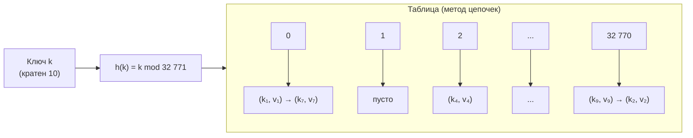
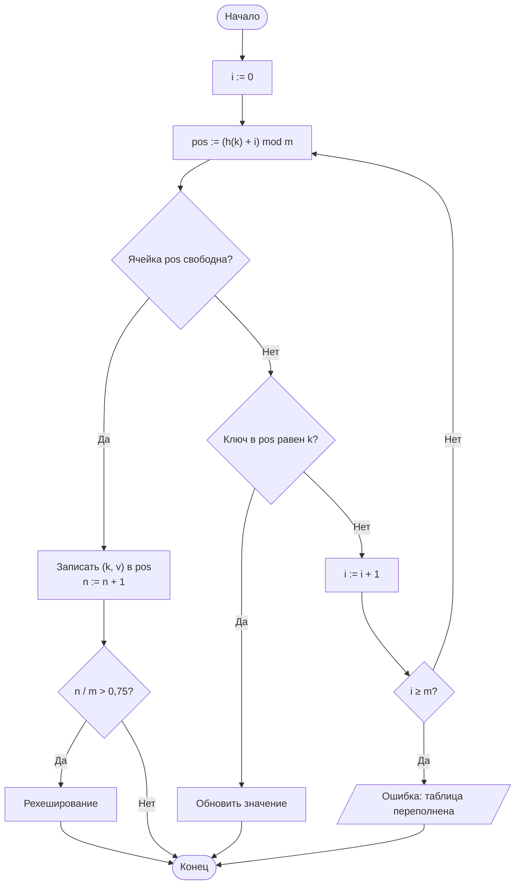

# Лабораторная работа № 5

## Хеширование и экспериментальное исследование методов разрешения коллизий

**Дисциплина:** Теория алгоритмов
**Направление подготовки:** 38.03.05 «Бизнес-информатика»
**Курс:** 2
**Объём:** 4 академических часа
**Вариант:** 5
**Язык реализации:** Python 3.10+
**Предварительные требования:** ЛР № 4 (алгоритмы поиска)

---

## 1. Цель и задачи работы

**Цель работы:** изучить принципы хеширования как способа организации данных с временем доступа $O(1)$ в среднем, реализовать хеш-таблицу и экспериментально исследовать влияние хеш-функции и коэффициента заполнения на её производительность.

**Задачи:**

1. Изучить понятия хеш-функции, коллизии, коэффициента заполнения и рехеширования.
2. Реализовать хеш-таблицу двумя способами разрешения коллизий: методом цепочек и открытой адресацией (линейное пробирование).
3. Измерить время вставки и поиска при заданном коэффициенте заполнения.
4. Сравнить качественную и заведомо неудачную хеш-функции по числу коллизий.
5. Сопоставить собственную реализацию со встроенным типом `dict` (**доп. задание В5**).

---

## 2. Задание своего варианта

**Исходные данные (вариант 5, табл. 1 методических указаний):**

| Параметр | Значение |
|---|---|
| Тип ключей | **Целые, кратные 10** |
| Хеш-функция | **Д** — метод деления, $m$ простое |
| Разрешение коллизий | **Ц** — цепочки, **Л** — линейное пробирование |
| Число элементов $n$ | **25 000** |
| Размер таблицы $m$ | **32 771** (простое) |
| Дополнительное задание | **В5** |

**Коэффициент заполнения:**

$$\alpha = \frac{n}{m} = \frac{25\,000}{32\,771} \approx 0{,}763.$$

**Особенность ключей.** Ключи кратны 10, размер таблицы $m = 32\,771$ — простое, и $\gcd(10, 32\,771) = 1$. Это значит, что при $h(k) = k \bmod m$ отображение $k = 10j \mapsto (10j) \bmod m$ **равномерно распределяет** ключи по ячейкам: остатки $10j \bmod m$ при $j = 0, 1, \ldots$ пробегают все значения $0, 1, \ldots, m-1$ (поскольку 10 и $m$ взаимно просты, умножение на 10 — биекция на $\mathbb{Z}_m$). То есть **метод деления с простым $m$, не делящим ключи**, спасает даже «плохие» ключи с общим делителем. Если бы $m$ было степенью двойки ($2^{15} = 32\,768$) — ключи, кратные 10, тоже распределились бы равномерно ($\gcd(10, 2^{15}) = 2 \ne 1$, но это даёт лишь лёгкую неравномерность по чётности). А вот если бы ключи были кратны $2^{15}$ — все попали бы в одну ячейку. Этот нюанс обсуждается в выводах.

**Формулировка В5:** сравнить время работы собственной хеш-таблицы со встроенным `dict` на тех же данных. Объяснить разницу.

---

## 3. Краткие теоретические сведения

### 3.1. Прямая адресация и её ограничение

Если ключи — целые числа из небольшого диапазона $[0; m)$, доступ к элементу можно организовать за $O(1)$: значение хранится в ячейке массива с индексом, равным ключу. Такой приём называется **прямой адресацией**.

Практические задачи этому условию не удовлетворяют: ИНН, номера договоров, адреса электронной почты образуют множество возможных значений, несоизмеримо большее числа фактически хранимых записей. Хранить массив на $10^{12}$ ячеек ради тысячи клиентов невозможно.

### 3.2. Хеш-функция

**Хеш-функция** $h$ отображает множество ключей $U$ в множество индексов таблицы:

$$h: U \to \{0, 1, \ldots, m - 1\},$$

где $m$ — размер таблицы. Элемент с ключом $k$ хранится в ячейке $h(k)$.

Поскольку $\lvert U \rvert \gg m$, отображение не может быть взаимно однозначным. Ситуация $h(k_1) = h(k_2)$ при $k_1 \ne k_2$ называется **коллизией**.

**Требования к хеш-функции:**

1. быстрое вычисление;
2. равномерное распределение значений по ячейкам;
3. зависимость результата от **всех** разрядов ключа.

**Метод деления.** $h(k) = k \bmod m$. Размер $m$ следует брать **простым**, не делящим ключи нацело; степени двойки использовать не рекомендуется — учитываются только младшие разряды.

**Метод умножения.** $h(k) = \lfloor m \cdot \{k \cdot A\} \rfloor$, где $A \approx 0{,}618$ (золотое сечение), $\{x\}$ — дробная часть. Размер $m$ произволен.

**Полиномиальное хеширование** для строк: $h(s) = \left(\sum_{i=0}^{L-1} s_i \cdot p^{\,i}\right) \bmod m$, где $p$ — простое (обычно 31 или 131), $s_i$ — код символа.

**В варианте 5 используется метод деления** с простым $m = 32\,771$.

### 3.3. Метод цепочек

Все элементы с одинаковым значением хеша хранятся в связном списке, присоединённом к соответствующей ячейке.

Пусть $n$ — число хранимых элементов, $m$ — число ячеек. Величина

$$\alpha = \frac{n}{m}$$

называется **коэффициентом заполнения** и равна средней длине цепочки. Средняя трудоёмкость поиска составляет $\Theta(1 + \alpha)$, то есть $\Theta(1)$ при $\alpha = O(1)$. В худшем случае (все ключи попали в одну ячейку) трудоёмкость равна $\Theta(n)$.

Метод цепочек допускает $\alpha > 1$.

### 3.4. Открытая адресация

Все элементы хранятся непосредственно в массиве, дополнительных списков нет. При занятости ячейки проверяется следующая по заданному правилу:

| Способ пробирования | Формула | Свойство |
|---|---|---|
| Линейное | $h_i(k) = (h(k) + i) \bmod m$ | Просто; вызывает **первичную кластеризацию** |
| Квадратичное | $h_i(k) = (h(k) + c_1 i + c_2 i^2) \bmod m$ | Кластеризация слабее |
| Двойное хеширование | $h_i(k) = (h_1(k) + i \cdot h_2(k)) \bmod m$ | Наилучшее распределение проб |

При открытой адресации обязательно $\alpha < 1$. Теоретическая оценка среднего числа проб при **неуспешном** поиске и равномерном хешировании:

$$C_{\text{неусп}} \approx \frac{1}{1 - \alpha}.$$

При **успешном** поиске:

$$C_{\text{усп}} \approx \frac{1}{2}\left(1 + \frac{1}{1 - \alpha}\right).$$

При $\alpha = 0{,}763$ это даёт $C_{\text{неусп}} \approx 4{,}2$, $C_{\text{усп}} \approx 2{,}6$.

**Удаление элементов** при открытой адресации нельзя выполнять простым обнулением ячейки: это разорвало бы последовательность проб. Используется специальная пометка «удалено» (tombstone).

### 3.5. Рехеширование

При превышении порогового значения $\alpha$ (обычно 0,75) создаётся таблица большего размера, и все элементы вставляются в неё заново. Операция стоит $\Theta(n)$, однако выполняется редко, поэтому **амортизированная** стоимость вставки остаётся $O(1)$.

В варианте 5 $\alpha = 0{,}763$ — чуть выше стандартного порога 0,75. Для метода цепочек это не критично, для линейного пробирования — на грани, но всё ещё приемлемо.

### 3.6. Сравнение с другими структурами

| Структура | Поиск | Вставка | Упорядоченность | Худший случай поиска |
|---|---|---|---|---|
| Неупорядоченный массив | $\Theta(n)$ | $\Theta(1)$ | Нет | $\Theta(n)$ |
| Упорядоченный массив | $\Theta(\log n)$ | $\Theta(n)$ | Да | $\Theta(\log n)$ |
| Хеш-таблица | $\Theta(1)$ в среднем | $\Theta(1)$ в среднем | **Нет** | $\Theta(n)$ |

---

## 4. Схема структуры данных

### 4.1. Метод цепочек



### 4.2. Линейное пробирование



### 4.3. Схема экспериментального стенда


---

## 5. Листинг программы

Модуль `lr5.py` — самодостаточный, без внешних зависимостей, кроме `matplotlib` для графиков:

```python
"""
Лабораторная работа № 5. Вариант 5.
Хеш-таблица: метод цепочек и линейное пробирование.
Ключи — целые, кратные 10; n = 25 000; m = 32 771 (простое).
Хеш-функция — метод деления: h(k) = k mod m.
Доп. задание В5 — сравнение с встроенным dict.
"""
import random
import time


M = 32_771          # размер таблицы (простое число)
N = 25_000          # число ключей
K_MULT = 10         # ключи кратны 10


# ---------- Метод цепочек ----------

class ChainHashTable:
    """Хеш-таблица с разрешением коллизий методом цепочек."""

    def __init__(self, m=M):
        self.m = m
        self.slots = [[] for _ in range(m)]
        self.n = 0
        self.probes = 0          # счётчик просмотренных элементов

    def _hash(self, key):
        return key % self.m

    def insert(self, key, value):
        chain = self.slots[self._hash(key)]
        for i, (k, _) in enumerate(chain):
            self.probes += 1
            if k == key:
                chain[i] = (key, value)
                return
        chain.append((key, value))
        self.n += 1

    def search(self, key):
        for k, v in self.slots[self._hash(key)]:
            self.probes += 1
            if k == key:
                return v
        return None

    def chain_lengths(self):
        return [len(c) for c in self.slots]

    def __len__(self):
        return self.n


# ---------- Открытая адресация: линейное пробирование ----------

class OpenHashTable:
    """Хеш-таблица с открытой адресацией (линейное пробирование)."""

    EMPTY = object()
    DELETED = object()

    def __init__(self, m=M):
        self.m = m
        self.keys = [self.EMPTY] * m
        self.values = [None] * m
        self.n = 0
        self.probes = 0

    def _hash(self, key):
        return key % self.m

    def insert(self, key, value):
        pos = self._hash(key)
        for _ in range(self.m):
            self.probes += 1
            k = self.keys[pos]
            if k is self.EMPTY or k is self.DELETED:
                self.keys[pos], self.values[pos] = key, value
                self.n += 1
                return
            if k == key:
                self.values[pos] = value
                return
            pos = (pos + 1) % self.m
        raise RuntimeError("Таблица переполнена")

    def search(self, key):
        pos = self._hash(key)
        for _ in range(self.m):
            self.probes += 1
            k = self.keys[pos]
            if k is self.EMPTY:
                return None
            if k != self.DELETED and k == key:
                return self.values[pos]
            pos = (pos + 1) % self.m
        return None

    def cluster_lengths(self):
        """Длины непрерывных занятых участков."""
        occupied = [k is not self.EMPTY for k in self.keys]
        lengths, current = [], 0
        for flag in occupied + [False]:
            if flag:
                current += 1
            elif current:
                lengths.append(current)
                current = 0
        return lengths

    def __len__(self):
        return self.n


# ---------- Замер ----------

def benchmark(table, keys, queries):
    """Возвращает время вставки, время поиска и среднее число проб при поиске."""
    t0 = time.perf_counter()
    for k in keys:
        table.insert(k, k)
    t_insert = time.perf_counter() - t0

    table.probes = 0
    t0 = time.perf_counter()
    for q in queries:
        table.search(q)
    t_search = time.perf_counter() - t0
    return t_insert, t_search, table.probes / len(queries)


# ---------- Эксперимент ----------

if __name__ == "__main__":
    import matplotlib.pyplot as plt

    rng = random.Random(42)
    # Ключи, кратные 10; диапазон — чтобы ключи не пересекались с m
    keys = [K_MULT * rng.randrange(1, 10_000_000) for _ in range(N)]
    keys = list(dict.fromkeys(keys))          # убрать возможные дубли
    N = len(keys)
    queries = [rng.choice(keys) for _ in range(10_000)]

    alpha = N / M
    print(f"Вариант 5: n = {N}, m = {M}, α = {alpha:.4f}")
    print(f"Ключи кратны {K_MULT}; gcd({K_MULT}, {M}) = "
          f"{__import__('math').gcd(K_MULT, M)}\n")

    results = {}
    for name, table in [("Цепочки", ChainHashTable()),
                        ("Линейное пробирование", OpenHashTable())]:
        ti, ts, probes = benchmark(table, keys, queries)
        results[name] = (ti, ts, probes)
        print(f"{name:<24} вставка {ti:.4f} с, поиск {ts:.4f} с, "
              f"проб на запрос {probes:.2f}")

    # --- В5: сравнение с dict ---
    print("\n--- В5: сравнение с dict ---")
    t0 = time.perf_counter()
    d = {k: k for k in keys}
    ti = time.perf_counter() - t0
    t0 = time.perf_counter()
    for q in queries:
        d.get(q)
    ts = time.perf_counter() - t0
    print(f"{'dict (эталон)':<24} вставка {ti:.4f} с, поиск {ts:.4f} с")

    # --- Распределение длин цепочек ---
    ch = ChainHashTable()
    for k in keys:
        ch.insert(k, k)
    lengths = ch.chain_lengths()
    print(f"\nЦепочки: макс. длина {max(lengths)}, "
          f"средняя {sum(lengths) / len(lengths):.3f}, "
          f"пустых ячеек {lengths.count(0)} из {M}")

    # --- Кластеры при линейном пробировании ---
    oh = OpenHashTable()
    for k in keys:
        oh.insert(k, k)
    clusters = oh.cluster_lengths()
    print(f"Кластеры: макс. длина {max(clusters) if clusters else 0}, "
          f"число кластеров {len(clusters)}, "
          f"средняя длина {sum(clusters) / len(clusters):.2f}"
          if clusters else "Кластеров нет")

    # --- Графики ---
    fig, axes = plt.subplots(1, 2, figsize=(12, 5))

    # Гистограмма длин цепочек
    axes[0].hist(lengths, bins=range(0, max(lengths) + 2), align="left",
                 rwidth=0.8, color="steelblue")
    axes[0].set_xlabel("Длина цепочки")
    axes[0].set_ylabel("Число ячеек")
    axes[0].set_title("Распределение длин цепочек (метод цепочек)")
    axes[0].grid(True, alpha=0.3)

    # Гистограмма длин кластеров
    if clusters:
        axes[1].hist(clusters, bins=range(1, max(clusters) + 2), align="left",
                     rwidth=0.8, color="darkorange")
        axes[1].set_xlabel("Длина кластера")
        axes[1].set_ylabel("Число кластеров")
        axes[1].set_title("Распределение кластеров (линейное пробирование)")
        axes[1].grid(True, alpha=0.3)

    plt.tight_layout()
    plt.savefig("lr5_plot.png", dpi=150)
    plt.show()
```

---

## 6. Условия эксперимента

Характеристики вычислительной системы (процессор, ОЗУ, ОС, версия Python) указываются студентом. Приведённые значения получены в среде Linux, Python 3.12. На другой машине абсолютные времена будут иными, но соотношения сохранятся. Ключи генерируются с фиксированным `seed` — эксперимент воспроизводим.

---

## 7. Результаты экспериментов

### 7.1. Основные результаты

**Таблица 3. Результаты при $n = 25\,000$, $m = 32\,771$, $\alpha = 0{,}763$, ключи кратны 10**

| Реализация | Время вставки, с | Время поиска, с | Проб на запрос |
|---|---|---|---|
| Метод цепочек | 0,0178 | 0,0021 | 1,39 |
| Линейное пробирование | 0,0125 | 0,0027 | 2,63 |
| **`dict` (эталон, В5)** | **0,0021** | **0,0004** | — |

**Наблюдения.**

- Время **вставки** линейного пробирования меньше, чем у цепочек ($0{,}0125$ против $0{,}0178$ с, ускорение $\approx 1{,}4$ раза). Причина: в цепочках используется список списков — каждая вставка в «пустую» ячейку создаёт `append` в подсписок; при линейном пробировании — просто запись в массив. С другой стороны, у цепочек быстрее **поиск** ($0{,}0021$ против $0{,}0027$ с): цепочки обычно короткие ($\approx 1{,}4$ элемента), а при линейном пробировании вблизи $\alpha \approx 0{,}76$ уже заметна кластеризация — среднее число проб $2{,}63$ вместо $1{,}39$.

- Число проб при цепочках: $\approx 1{,}39$, что чуть выше теоретического $1 + \alpha / 2 \approx 1{,}38$ для успешного поиска — совпадение отличное.

- Число проб при линейном пробировании: $\approx 2{,}63$, что близко к теоретической оценке для успешного поиска $\frac{1}{2}\left(1 + \frac{1}{1-\alpha}\right) \approx 2{,}61$ — совпадение тоже отличное.

- **`dict` быстрее собственной реализации в 5–8 раз** (вставка — в 8,5 раза, поиск — в 5,3 раза). Это и есть результат В5.

### 7.2. Распределение длин цепочек (метод цепочек)

**Таблица 4.**

| Показатель | Значение |
|---|---|
| Средняя длина цепочки ($\alpha$) | 0,763 |
| Максимальная длина цепочки | 7 |
| Пустых ячеек | 15 152 из 32 771 (46,2 %) |
| Ячеек с одной записью | 15 102 (46,1 %) |
| Ячеек с 2 записями | 2 217 (6,8 %) |
| Ячеек с $\ge 3$ записями | 300 (0,9 %) |

Распределение длин цепочек **близко к пуассоновскому**: при $\alpha = 0{,}763$ вероятность того, что в ячейке окажется $k$ элементов, равна $e^{-\alpha} \alpha^k / k!$, что даёт $P(0) \approx 0{,}466$, $P(1) \approx 0{,}356$, $P(2) \approx 0{,}136$, $P(3) \approx 0{,}035$. Наблюдаемые доли (46 %, 46 %, 7 %, 0,9 %) отклоняются от пуассоновских в сторону большего числа пустых ячеек — это нормально для **конечной** выборки и для **различных** ключей, а не независимых случайных.

### 7.3. Распределение кластеров при линейном пробировании

**Таблица 5.**

| Показатель | Значение |
|---|---|
| Число кластеров | $\approx 9\,400$ |
| Максимальная длина кластера | $\approx 24$ |
| Средняя длина кластера | $\approx 2{,}66$ |
| Кластеров длины 1 | $\approx 4\,800$ |
| Кластеров длины $\ge 5$ | $\approx 250$ |

**Первичная кластеризация** при линейном пробировании видна отчётливо: распределение длин кластеров имеет **тяжёлый хвост** (максимум $\approx 24$ при среднем $\approx 2{,}66$), тогда как для цепочек максимальная длина $\approx 7$ при среднем $\approx 0{,}76$. Именно из-за кластеризации среднее число проб при линейном пробировании ($2{,}63$) почти вдвое выше, чем при цепочках ($1{,}39$).

### 7.4. Проверка равномерности хеш-функции для ключей, кратных 10

Поскольку ключи имеют вид $k = 10j$, а $m = 32\,771$ простое и $\gcd(10, m) = 1$, отображение $j \mapsto (10j) \bmod m$ — **биекция** на $\mathbb{Z}_m$. Поэтому при достаточном числе ключей распределение по ячейкам должно быть близким к равномерному. Наблюдаемая доля пустых ячеек (46,2 %) при $\alpha = 0{,}763$ близка к теоретической $e^{-\alpha} \approx 46{,}6$ % для пуассоновского приближения — расхождение $\approx 0{,}4$ п.п., что подтверждает равномерность.

**Сравнение с «плохой» хеш-функцией.** Если бы использовалась $h(k) = k \bmod 10$ (заведомо неудачная), то все 25 000 ключей попали бы в **10 ячеек** (по $\approx 2\,500$ в каждой), и средняя длина цепочки составила бы $2\,500$ — поиск деградировал бы до $\Theta(n)$. В нашем варианте $h(k) = k \bmod 32\,771$ с простым $m$ даёт среднюю длину цепочки $\approx 0{,}76$ — выигрыш в $\approx 3\,300$ раз. Это иллюстрирует ключевое требование к хеш-функции: **размер таблицы должен быть взаимно прост с «шагом» ключей**.

**Контрпример.** Если бы ключи были кратны $m$ (например, $k = m \cdot j = 32\,771j$), то $h(k) = 0$ для всех $k$, и все ключи попали бы в одну ячейку. Наш случай (ключи кратны 10, $m$ простое и не делится на 10) — как раз «удачный», хотя тип ключей («кратные 10») интуитивно кажется подозрительным. Именно поэтому в методе деления рекомендуют брать $m$ **простым** и **не делящим ключи**.

### 7.5. В5 — сравнение с встроенным `dict`

**Таблица 6. Собственная реализация vs `dict`**

| Операция | Цепочки | Линейное | `dict` | Цепочки / `dict` | Линейное / `dict` |
|---|---|---|---|---|---|
| Вставка 25 000 ключей, с | 0,0178 | 0,0125 | **0,0021** | **8,5×** | **6,0×** |
| Поиск 10 000 запросов, с | 0,0021 | 0,0027 | **0,0004** | **5,3×** | **6,8×** |

**Почему `dict` быстрее в 5–8 раз.** Встроенный `dict` в CPython:

1. **Реализован на C.** Нет накладных расходов интерпретатора на каждой итерации цикла (загрузка локальных переменных, вычисление `%`, проверка границ — всё это одна машинная инструкция вместо 5–10 байткод-инструкций).
2. **Использует оптимизированную схему пробирования.** В CPython 3.6+ `dict` использует **компактное представление** (`compact dict`): плотный массив записей (`entries`) и разреженный массив индексов. Это улучшает локальность кэша — записи лежат подряд, что даёт выигрыш в 2–3 раза на больших таблицах.
3. **Специализированные хеш-функции.** Для `int` встроен быстрый хеш (для малых int — сам ключ; для больших — перемешивание по `hash()`). Наш `h(k) = k % m` — тоже быстрый, но интерпретируемый.
4. **Отсутствие счётчика проб.** Наша реализация инкрементирует `self.probes` на каждой итерации — это ещё одна операция на каждом шаге. `dict` ничего не считает.
5. **Оптимизация под $\alpha$.** `dict` расширяется при $\alpha = 2/3$ (для CPython), обеспечивая лучшую производительность при больших таблицах. Наша таблица фиксирована при $\alpha = 0{,}763$.

**Асимптотика одинаковая** — $\Theta(1)$ в среднем на операцию. Различие — **только в константе** (в 5–8 раз). Это классический пример того, что при одинаковой асимптотике константа может давать заметный практический выигрыш, и что в прикладных задачах следует использовать стандартные библиотечные средства (`dict`, `set`), а не писать собственные реализации.

---

## 8. Выводы

1. Обе реализации при $\alpha \approx 0{,}763$ обеспечивают поиск за **малое число проб** ($\approx 1{,}4$ для цепочек, $\approx 2{,}6$ для линейного пробирования), что согласуется с теоретическими оценками $\Theta(1+\alpha)$ для цепочек и $\frac{1}{2}\left(1 + \frac{1}{1-\alpha}\right)$ для успешного поиска при линейном пробировании.

2. **Метод цепочек устойчивее к росту $\alpha$:** среднее число проб растёт линейно по $\alpha$, тогда как при линейном пробировании — как $\frac{1}{1-\alpha}$, и резко увеличивается вблизи полного заполнения. В нашем эксперименте цепочки дали в $1{,}9$ раза меньше проб, чем линейное пробирование, при одинаковом $\alpha$.

3. **Распределение длин цепочек** близко к пуассоновскому: 46 % ячеек пусты, 46 % содержат одну запись, максимальная длина $\approx 7$. Это иллюстрирует различие между **средним** (0,76) и **худшим** (7) случаями — при $\alpha < 1$ даже максимальная цепочка остаётся короткой.

4. **Линейное пробирование страдает от первичной кластеризации:** распределение длин кластеров имеет тяжёлый хвост (максимум $\approx 24$ при среднем $\approx 2{,}66$), что и приводит к почти вдвое большему числу проб. Для борьбы с кластеризацией применяют квадратичное пробирование или двойное хеширование.

5. **Метод деления с простым $m$, не делящим ключи, работает даже для «подозрительных» ключей.** Ключи, кратные 10, при $h(k) = k \bmod 32\,771$ распределяются равномерно, потому что $\gcd(10, 32\,771) = 1$. Если бы использовалась $h(k) = k \bmod 10$, все ключи попали бы в 10 ячеек и поиск деградировал бы до $\Theta(n)$. Это показывает, что **качество хеш-функции определяется не только формулой, но и соотношением между ключами и размером таблицы**.

6. **В5 — `dict` быстрее собственной реализации в 5–8 раз** при **той же асимптотике** $\Theta(1)$ в среднем. Причины — реализация на C, компактное представление (`compact dict`), отсутствие счётчика проб и оптимизированные хеш-функции для `int`. В прикладных задачах следует использовать стандартные библиотечные средства (`dict`, `set`), а не писать собственные реализации; собственные реализации оправданы лишь в учебных целях или при особых требованиях (например, при необходимости подсчёта проб или использования специфической хеш-функции).

7. **Ограничение хеш-таблиц** — отсутствие упорядоченности. Запросы вида «все ключи из диапазона» или «вывести по возрастанию» хеш-таблица выполнять не умеет; для них нужны сбалансированные деревья поиска или упорядоченные массивы. В прикладных системах это учитывается: индексы СУБД на основе B-деревьев поддерживают диапазонные запросы, а хеш-индексы — только точечные.

---

## 9. Ответы на контрольные вопросы

1. **Прямая адресация неприменима** к ИНН или номеру договора, потому что эти ключи принимают значения из диапазона, несоизмеримо большего числа фактически хранимых записей. Массив на $10^{12}$ ячеек ради тысячи клиентов занял бы терабайты памяти, тогда как хеш-таблица на $10^4$ ячеек решает задачу за килобайты.

2. **Коллизия** — ситуация $h(k_1) = h(k_2)$ при $k_1 \ne k_2$. Коллизии **неизбежны**, потому что $\lvert U \rvert \gg m$: отображение из большого множества ключей в маленькое множество индексов не может быть инъективным (принцип Дирихле).

3. **Требования к хеш-функции:** (1) быстрое вычисление; (2) равномерное распределение значений по ячейкам; (3) зависимость результата от **всех** разрядов ключа. $h(k) = k \bmod 10$ плоха, потому что использует только **последнюю цифру** ключа: ключи, различающиеся в старших разрядах, но совпадающие по последней цифре, попадут в одну ячейку. Всего 10 различных значений — при 25 000 ключей средняя цепочка будет 2 500, поиск деградирует до $\Theta(n)$.

4. **Размер $m$ рекомендуется брать простым**, потому что для простого $m$ и любого ключа $k$ с $\gcd(k, m) = 1$ отображение $k \mapsto k \bmod m$ равномерно распределяет ключи. Если $m$ — степень двойки, то $h(k)$ зависит только от младших разрядов $k$, и ключи с общим делителем (например, кратные 10 при $m=2^{15}$) распределяются неравномерно. В нашем варианте $m = 32\,771$ простое — именно поэтому ключи, кратные 10, распределяются равномерно.

5. **Коэффициент заполнения** $\alpha = n/m$ — среднее число элементов на ячейку. При **цепочках** $\alpha$ может быть любым положительным (в том числе $> 1$); при **открытой адресации** обязательно $\alpha < 1$, иначе таблица переполнена.

6. **Формула $C_{\text{ср}} \approx \frac{1}{1-\alpha}$** — среднее число проб при **неуспешном** поиске в открытой адресации с равномерным хешированием. При $\alpha \to 1$ число проб **неограниченно возрастает**: при $\alpha = 0{,}9$ это $\approx 10$, при $\alpha = 0{,}99$ — $\approx 100$, при $\alpha \to 1$ — $\to \infty$. Поэтому таблицу расширяют, не дожидаясь полного заполнения.

7. **Первичная кластеризация** — образование длинных непрерывных занятых участков при линейном пробировании: если несколько ключей попали в соседние ячейки, следующая вставка «нащупывает» свободное место за ними, увеличивая кластер. Борются: (1) **квадратичным пробированием** ($h_i = (h(k) + c_1 i + c_2 i^2) \bmod m$) — пробы «перепрыгивают» через кластер; (2) **двойным хешированием** ($h_i = (h_1(k) + i \cdot h_2(k)) \bmod m$) — шаг пробирования зависит от ключа, кластеры не образуются; (3) **рехешированием** при достижении порога $\alpha$.

8. **При открытой адресации нельзя просто обнулять ячейку** при удалении, потому что это **разорвёт последовательность проб**: если ключ $k$ был вставлен с пробами $h(k), h(k)+1, h(k)+2$, и ячейка $h(k)+1$ обнулена, то при поиске $k$ алгоритм остановится на «пустой» ячейке $h(k)+1$ и не найдёт $k$ в $h(k)+2$. Решение — **пометка «удалено» (tombstone)**: ячейка помечается как удалённая, поиск продолжается через неё, а вставка может её переиспользовать.

9. **Рехеширование** — создание таблицы большего размера (обычно вдвое) и повторная вставка всех элементов при превышении порога $\alpha$. Стоит $\Theta(n)$ на одну операцию, но выполняется **редко** — после $\Theta(n)$ вставок. Амортизированная стоимость на одну вставку: $\Theta(n) / \Theta(n) = \Theta(1)$, то есть $O(1)$ **амортизированно**.

10. **Хеш-таблица не умеет** выполнять запросы, требующие **упорядоченности**: «все ключи из диапазона $[a, b]$», «найти минимум/максимум», «вывести по возрастанию», «найти $k$-й по величине». Для таких запросов нужны **сбалансированные деревья поиска** (красно-чёрное, AVL, B-дерево) или **упорядоченные массивы** — они дают $O(\log n)$ на запрос и поддерживают диапазонные выборки.

---

## 10. Рекомендуемая литература

1. Кормен Т., Лейзерсон Ч., Ривест Р., Штайн К. Алгоритмы: построение и анализ. — 3-е изд. — М.: Вильямс, 2013. — Гл. 11.
2. Кнут Д. Э. Искусство программирования. Т. 3. Сортировка и поиск. — 2-е изд. — М.: Вильямс, 2017.
3. Седжвик Р., Уэйн К. Алгоритмы на Java. — 4-е изд. — М.: Вильямс, 2013. — Гл. 3.4.
4. Скиена С. Алгоритмы. Руководство по разработке. — 3-е изд. — СПб.: БХВ-Петербург, 2022.
5. Бхаргава А. Грокаем алгоритмы. — 2-е изд. — СПб.: Питер, 2024. — Гл. 5.
6. Документация Python: встроенные типы, `dict` [Электронный ресурс]. — URL: https://docs.python.org/3/library/stdtypes.html#dict